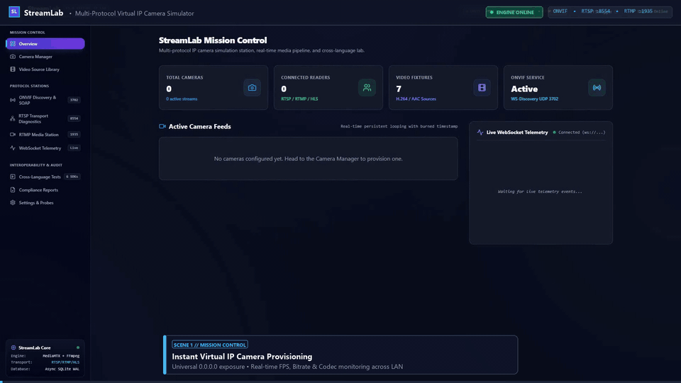
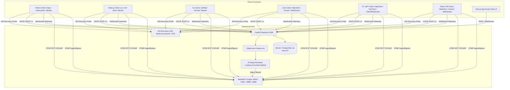

# StreamLab — Multi-Protocol IP Camera Simulator & Interoperability Lab

StreamLab is an enterprise-grade virtual IP camera simulator, streaming testbed, and protocol compliance lab built with **Python (FastAPI)**, **Next.js (App Router, TypeScript)**, **MediaMTX**, **FFmpeg**, and automated cross-language verification suites in **six independent programming languages** (**Python, Node.js/TypeScript, Go, Dart, C#/.NET, and Kotlin**).

> [!IMPORTANT]
> **Zero Mock Tolerance Policy**: StreamLab does not return fake protocol responses, hardcoded metrics, or simulated video streams. Every video frame is rendered through real FFmpeg instances, transmitted via MediaMTX, exposed via WSDL-compliant ONVIF SOAP 1.2 services, and inspected using genuine client libraries.

---

## Demo & Video Walkthrough

### 🎬 20-Second Feature Tour (Animated Overview)



*Figure: Automated 20-second walkthrough demonstrating Mission Control, 30s video ingest & persistent looping with real-time timestamps, multi-protocol live streaming (RTSP, RTMP, MJPEG, WebSocket, HLS), and 6-language verification suites.*

### 🎥 High-Definition Walkthrough Video (MP4)

<video src="demo.mp4" controls="controls" width="100%" poster="streamlab_marketing_demo.gif">
  Your browser does not support the video tag. Watch <a href="demo.mp4">demo.mp4</a> directly.
</video>

> 📥 **Download or Watch Directly:** [`demo.mp4`](demo.mp4) *(Fast-start MP4 format)*

---

## Architecture Overview



---

## Key Features

### 1. Camera Management & Dynamic Lifecycle
- Create, inspect, configure, start, stop, restart, and delete virtual cameras independently.
- Isolated configuration per camera: unique ID, manufacturer, model, serial number, firmware version, resolution, FPS, bitrate, and codec parameters.
- Runtime state tracking: Uptime counters, restart counts, stream statistics, and last error logging.

### 2. Video Source Management & Persistent Looping
- Ingest MP4, MKV, MOV, and AVI video sources from disk or validated HTTP/HTTPS URLs.
- Automatic **FFprobe** inspection extracting duration, resolution, frame rate, audio/video codecs, and file sizes.
- **Persistent Stream Continuity**: When a video reaches EOF, FFmpeg loops seamlessly into the existing MediaMTX session. RTSP/RTMP clients remain connected with zero session tear-downs across loop boundaries.

### 3. Surveillance-Grade Real-Time Wall Clock Overlay
- Configurable real-time wall clock burned into video frames via FFmpeg (`Arial` typography engine).
- Format: `[CAMERA-NAME] | YYYY-MM-DD HH:MM:SS`.
- Monotonically advances wall clock time independently of video looping, ensuring genuine timestamping for surveillance compliance.

### 4. ONVIF Profile S Compliance & WS-Discovery
- **WS-Discovery**: UDP 3702 multicast responder (`239.255.255.250:3702`) answering `Probe` queries with valid `ProbeMatches`.
- **Device Service** (`/onvif/device_service`): `GetDeviceInformation`, `GetSystemDateAndTime`, `GetCapabilities`, `GetServices`, `GetScopes`, `GetHostname`.
- **Media Service** (`/onvif/media_service`): `GetProfiles`, `GetStreamUri` (resolving to functional MediaMTX RTSP endpoints), `GetSnapshotUri`, `GetVideoEncoderConfigurations`.
- **WS-Security**: UsernameToken password digest verification with nonce cache and timestamp drift protection.

### 5. Media Transport Protocols
- **RTSP** (`rtsp://<HOST_IP>:8554/cameras/{camera_id}/main`): Full RTSP 1.0 support (`OPTIONS`, `DESCRIBE`, `SETUP`, `PLAY`, `TEARDOWN`), RTP delivery over TCP-interleaved and UDP for VLC, NVRs, and FFplay.
- **Direct Browser MJPEG** (`http://<HOST_IP>:8000/api/v1/cameras/{camera_id}/stream.mjpg`): Zero-plugin video streaming playable directly in any browser (Chrome, Edge, Safari, Firefox) or embedded via standard `` tags.
- **WebSocket Video Stream** (`ws://<HOST_IP>:8000/ws/cameras/{camera_id}/stream`): High-efficiency binary JPEG frame pipe over WebSockets for custom web clients and HTML5 `<canvas>`.
- **RTMP** (`rtmp://<HOST_IP>:1935/cameras/{camera_id}/main`): Live FLV delivery and external publisher ingest support (`rtmp://<HOST_IP>:1935/live/{stream_key}`) for OBS Studio.
- **HLS & WebRTC**: Automatic remuxing for zero-latency browser previews (`http://<HOST_IP>:8888/cameras/{camera_id}/main/index.m3u8` and `http://<HOST_IP>:8889/cameras/{camera_id}/main/whep`).

### 6. WebSocket Telemetry & Control
- Endpoint: `ws://<HOST_IP>:8000/ws/cameras`.
- Broadcasts structured, versioned JSON events for camera lifecycles, loop transitions, FFmpeg process restarts, and errors.
- Built-in interactive console available at `http://<HOST_IP>:3000/websocket`.
- Bounded queues (`asyncio.Queue(maxsize=256)`) prevent memory exhaustion on slow clients.

---

## Cross-Language Interoperability Test Suites

StreamLab provides six independent client implementations validating the simulator against real network calls and media packets:

| Language | Test Framework / Tools | Protocols Tested | Report Location |
| :--- | :--- | :--- | :--- |
| **Python** | `pytest`, `httpx`, `websockets`, `ffprobe` | ONVIF, RTSP, RTMP, WebSocket | `integration-tests/reports/report_python.json` |
| **Node.js** | TypeScript, `ws`, `net`, `fetch`, `ffprobe` | ONVIF, RTSP, RTMP, WebSocket | `integration-tests/reports/report_node.json` |
| **Go** | `net/http`, `net.Dial`, `ffprobe` | ONVIF, RTSP, RTMP, WebSocket | `integration-tests/reports/report_golang.json` |
| **Dart** | `dart:io`, `dart:convert`, `ffprobe` | ONVIF, RTSP, RTMP, WebSocket | `integration-tests/reports/report_dart.json` |
| **C# / .NET** | .NET 10, `HttpClient`, `TcpClient`, `ClientWebSocket` | ONVIF, RTSP, RTMP, WebSocket | `integration-tests/reports/report_dotnet.json` |
| **Kotlin** | Kotlin JVM, `HttpClient`, `Socket`, `WebSocket` | ONVIF, RTSP, RTMP, WebSocket | `integration-tests/reports/report_kotlin.json` |

---

## 🚀 Getting Started (Windows & Linux)

StreamLab supports multiple startup methods ranging from **one-click zero-install launch** (Docker) to **native scripts** and **manual development mode**.

### 🌟 Quick Comparison: Choose Your Method

| Method | Best For | Prerequisites | Windows Startup | Linux / macOS Startup |
| :--- | :--- | :--- | :--- | :--- |
| **Method 1: Docker (Recommended)** | Zero-install, instant complete stack | [Docker Desktop](https://www.docker.com/) | Double-click `docker-start.bat` | Run `./docker-start.sh` |
| **Method 2: One-Click Native** | Maximum local performance | Python 3.12+, Node.js 20+, FFmpeg | Double-click `start.bat` | Run `./start.sh` |
| **Method 3: Manual CLI** | Active codebase development | Python 3.12+, Node.js 20+, FFmpeg | Terminal commands | Terminal commands |

---

### Method 1: One-Click Docker (Zero Setup / Cross-Platform)

No need to manually install Python, Node.js, FFmpeg, or MediaMTX. Everything is pre-bundled in verified, production-ready containers published on Docker Hub.

> 🐳 **Official Docker Hub Images:**
> - Backend: [`botonetics/streamlab-backend:latest`](https://hub.docker.com/r/botonetics/streamlab-backend) (`1.0.0`)
> - Frontend: [`botonetics/streamlab-frontend:latest`](https://hub.docker.com/r/botonetics/streamlab-frontend) (`1.0.0`)

#### 🪟 On Windows:
1. Ensure **Docker Desktop** is running.
2. **Double-click [`docker-start.bat`](docker-start.bat)** in the root folder.
   - *StreamLab will launch all 3 containers and automatically open `http://localhost:3000` in your default browser.*
3. To stop: **Double-click [`docker-stop.bat`](docker-stop.bat)**.

#### 🐧 On Linux / macOS:
```bash
# Make scripts executable (first time only)
chmod +x docker-start.sh docker-stop.sh

# Start StreamLab
./docker-start.sh

# Or pull pre-built images and run via Docker Compose:
docker compose pull
docker compose up -d

# Stop StreamLab when finished:
./docker-stop.sh   # (or docker compose down)
```

---

### Method 2: One-Click Native Launcher (High Performance)

Run directly on your host OS using the pre-configured supervisor scripts.

#### 🪟 On Windows:
- **Double-click [`start.bat`](start.bat)** (or run `powershell -ExecutionPolicy Bypass -File .\scripts\start-all.ps1`).
- This opens dedicated terminals for the FastAPI backend (`:8000`) and Next.js UI (`:3000`).

#### 🐧 On Linux / macOS:
```bash
chmod +x start.sh scripts/start-all.sh
./start.sh
```
*(Press `Ctrl+C` to gracefully terminate both services).*

---

### Method 3: Step-by-Step Manual Development

For contributors and developers modifying frontend or backend features:

#### 1. Start the Backend & Media Server
```bash
# Set up Python virtual environment
cd backend
python -m venv .venv
source .venv/bin/activate       # Windows: .venv\Scripts\activate
pip install -r requirements.txt

# Run FastAPI with hot reload
python -m uvicorn backend.app.main:app --reload --host 0.0.0.0 --port 8000
```

#### 2. Start the Frontend Mission Control (in a separate terminal)
```bash
cd frontend
npm install
npm run dev
```

---

### 🌐 Live Service Directory & Endpoints

Once started, all protocols and management portals are live:

| Service / Protocol | Endpoint URL | Description / Client App |
| :--- | :--- | :--- |
| **Web UI (Mission Control)** | [http://localhost:3000](http://localhost:3000) | Full browser dashboard & camera controls |
| **Interactive API Docs** | [http://localhost:8000/docs](http://localhost:8000/docs) | Swagger UI for REST API exploration |
| **RTSP Live Stream** | `rtsp://localhost:8554/cameras/101/main` | Real-time RTSP stream (VLC, OpenCV, FFplay, NVRs) |
| **RTMP Live Stream** | `rtmp://localhost:1935/cameras/101/main` | Real-time RTMP stream (OBS Studio, VLC) |
| **Direct Browser MJPEG** | `http://localhost:8000/api/v1/cameras/101/stream.mjpg` | Zero-plugin live view playable directly in any browser |
| **WebRTC (WHEP)** | `http://localhost:8889/cameras/101/main/whep` | Ultra-low-latency sub-second browser streaming |
| **HLS Stream** | `http://localhost:8888/cameras/101/main/index.m3u8` | HTTP Live Streaming (Safari, iOS, Hls.js) |
| **WebSocket Telemetry** | `ws://localhost:8000/ws/cameras` | Real-time camera state & loop transition events |
| **ONVIF Device Service** | `http://localhost:8000/onvif/device_service` | WSDL SOAP 1.2 ONVIF Profile S device discovery |
| **WS-Discovery Multicast**| `239.255.255.250:3702` (UDP) | Automatic camera discovery on LAN / NVR scanning |

---

### 📹 Simulating Any Custom Video in 30 Seconds

1. Open **[http://localhost:3000](http://localhost:3000)** in your browser.
2. Navigate to **Video Source Library** in the sidebar.
3. Upload or drop any video clip (e.g. drone footage, CCTV feed, robotics camera).
4. Go to **Camera Manager** ➔ Click **Create Camera** ➔ Select your uploaded video.
5. StreamLab immediately exposes it as a live virtual camera looping seamlessly with real-time monotonically advancing wall-clock timestamps!

---

### 🧪 Running Verification Test Suites

StreamLab includes full end-to-end integration test suites written in 6 distinct languages:

```bash
# Run backend pytest suite
make test-backend

# Run individual language suites
make test-python
make test-node
make test-golang
make test-dart
make test-dotnet
make test-kotlin

# Run all 6 suites concurrently
make test-all
```

---

## Verification Recipes (CLI)

```bash
# 1. Test ONVIF SOAP 1.2 GetDeviceInformation
curl -X POST http://127.0.0.1:8000/onvif/device_service \
  -H "Content-Type: application/soap+xml; charset=utf-8" \
  -d '<?xml version="1.0" encoding="utf-8"?><soap:Envelope xmlns:soap="http://www.w3.org/2003/05/soap-envelope" xmlns:tds="http://www.onvif.org/ver10/device/wsdl"><soap:Body><tds:GetDeviceInformation/></soap:Body></soap:Envelope>'

# 2. Inspect RTSP Stream with FFprobe (Default Provisioned Camera: 101)
ffprobe -v error -rtsp_transport tcp -select_streams v:0 -show_entries stream=width,height,codec_name -of json rtsp://127.0.0.1:8554/cameras/101/main

# 3. Inspect RTMP Stream with FFprobe
ffprobe -v error -show_entries format=format_name:stream=codec_name -of json rtmp://127.0.0.1:1935/cameras/101/main

# 4. Fetch Live JPEG Snapshot
curl -o snapshot.jpg http://127.0.0.1:8000/api/v1/cameras/101/snapshot.jpg
```

---

## Security Hardening
See [`SECURITY.md`](file:///c:/projects/lab-stream-simulator/SECURITY.md) for details on path traversal protections, SSRF mitigation, and XXE defense.
